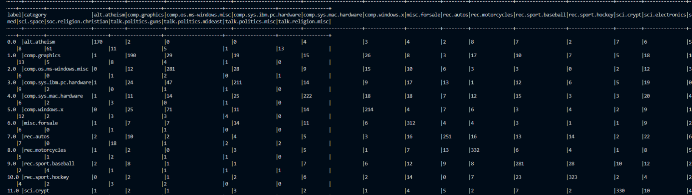

# PA2: Document Classification with Random Forest

## Task 3: Baseline results (validation set)

| Model | Accuracy | Weighted F1 | Fit time |
|---|---:|---:|---:|
| Majority class (rec.sport.hockey) | 0.0499 | 0.0047 | n/a |
| Random Forest (20 trees, depth 5, minInstancesPerNode 1) | 0.4266 | 0.4115 | 4.5 s |

## Task 4: Hyperparameter tuning (validation set)

| numTrees | maxDepth | minInstancesPerNode | Accuracy | Weighted F1 | Fit time (s) |
|---:|---:|---:|---:|---:|---:|
| 1 | 5 | 1 | 0.1238 | 0.0808 | 1.4 |
| 1 | 5 | 5 | 0.1238 | 0.0808 | 1.3 |
| 1 | 10 | 1 | 0.2049 | 0.1730 | 1.9 |
| 1 | 10 | 5 | 0.1868 | 0.1719 | 1.9 |
| 1 | 25 | 1 | 0.2919 | 0.3005 | 3.9 |
| 1 | 25 | 5 | 0.2906 | 0.3070 | 3.8 |
| 5 | 5 | 1 | 0.2226 | 0.2049 | 1.4 |
| 5 | 5 | 5 | 0.2502 | 0.2324 | 1.4 |
| 5 | 10 | 1 | 0.3577 | 0.3638 | 2.0 |
| 5 | 10 | 5 | 0.3803 | 0.3695 | 2.1 |
| 5 | 25 | 1 | 0.5009 | 0.5015 | 5.0 |
| 5 | 25 | 5 | 0.5009 | 0.4965 | 4.8 |
| 20 | 5 | 1 | 0.4266 | 0.4115 | 1.4 |
| 20 | 5 | 5 | 0.4461 | 0.4349 | 1.4 |
| 20 | 10 | 1 | 0.5295 | 0.5189 | 3.0 |
| 20 | 10 | 5 | 0.5286 | 0.5154 | 2.7 |
| 20 | 25 | 1 | 0.6523 | 0.6463 | 10.1 |
| 20 | 25 | 5 | 0.6405 | 0.6374 | 8.6 |
| 50 | 5 | 1 | 0.4900 | 0.4732 | 1.9 |
| 50 | 5 | 5 | 0.5227 | 0.5070 | 1.9 |
| 50 | 10 | 1 | 0.5884 | 0.5770 | 4.4 |
| 50 | 10 | 5 | 0.6015 | 0.5973 | 4.4 |
| 50 | 25 | 1 | 0.7126 | 0.7070 | 20.6 |
| 50 | 25 | 5 | 0.6886 | 0.6841 | 17.1 |
| 100 | 5 | 1 | 0.5535 | 0.5328 | 2.7 |
| 100 | 5 | 5 | 0.5589 | 0.5411 | 2.9 |
| 100 | 10 | 1 | 0.6197 | 0.6089 | 7.0 |
| 100 | 10 | 5 | 0.6129 | 0.5993 | 7.2 |
| **100** | **25** | **1** | **0.7303** | **0.7252** | **40.4** |
| 100 | 25 | 5 | 0.7017 | 0.6958 | 33.6 |

**Selected configuration:** numTrees = 100, maxDepth = 25, minInstancesPerNode = 1 (featureSubsetStrategy = sqrt, maxBins = 32, seed = 42). Highest validation weighted F1 (0.7252).

### Accuracy–runtime tradeoffs

Tree depth had the largest effect on quality. With 100 trees, increasing maxDepth from 5 to 25 raised validation weighted F1 from 0.533 to 0.725. Adding trees also helped, but with diminishing returns: at depth 25, weighted F1 went from 0.30 with one tree to 0.50, 0.65, 0.71 and 0.73 with 5, 20, 50 and 100 trees.

Runtime grows with both the number of trees and the depth. The depth-5 forests all trained in about 1.3 to 2.9 seconds, while the depth-25 forests went from about 4 seconds (one tree) to 40.4 seconds (100 trees). Going from 50 to 100 trees at depth 25 doubled the fit time (20.6 s to 40.4 s) for only 0.018 more weighted F1, so the 50-tree forest would be a reasonable choice if training time mattered. Setting minInstancesPerNode to 5 helped the shallow forests slightly but lowered F1 for the deep forests with 5 or more trees. I picked the configuration with the highest validation weighted F1, which was also the slowest one.

## Task 5: Final model (official test set)

Fit on the full official training set (11,314 documents, IDF refit), evaluated once on the test set (7,532 documents).

### Final model accuracy

**Accuracy: 0.6348**

| Metric | Test |
|---|---:|
| Weighted precision | 0.6398 |
| Weighted recall | 0.6348 |
| Weighted F1 | 0.6261 |
| Macro F1 | 0.6215 |

### Precision, recall, F1 (per class)

| Label | Category | Support | Precision | Recall | F1 |
|---:|---|---:|---:|---:|---:|
| 0 | alt.atheism | 319 | 0.7054 | 0.5329 | 0.6071 |
| 1 | comp.graphics | 389 | 0.5398 | 0.4884 | 0.5128 |
| 2 | comp.os.ms-windows.misc | 394 | 0.5818 | 0.7132 | 0.6408 |
| 3 | comp.sys.ibm.pc.hardware | 392 | 0.5829 | 0.5383 | 0.5597 |
| 4 | comp.sys.mac.hardware | 385 | 0.6082 | 0.5766 | 0.5920 |
| 5 | comp.windows.x | 395 | 0.6045 | 0.5418 | 0.5714 |
| 6 | misc.forsale | 390 | 0.6329 | 0.8000 | 0.7067 |
| 7 | rec.autos | 396 | 0.6765 | 0.6338 | 0.6545 |
| 8 | rec.motorcycles | 398 | 0.6734 | 0.8342 | 0.7452 |
| 9 | rec.sport.baseball | 397 | 0.6030 | 0.7078 | 0.6512 |
| 10 | rec.sport.hockey | 399 | 0.7099 | 0.8095 | 0.7564 |
| 11 | sci.crypt | 396 | 0.7449 | 0.8333 | 0.7867 |
| 12 | sci.electronics | 393 | 0.3213 | 0.3181 | 0.3197 |
| 13 | sci.med | 396 | 0.6266 | 0.3687 | 0.4642 |
| 14 | sci.space | 394 | 0.6906 | 0.7817 | 0.7333 |
| 15 | soc.religion.christian | 398 | 0.6421 | 0.8744 | 0.7404 |
| 16 | talk.politics.guns | 364 | 0.5833 | 0.7308 | 0.6488 |
| 17 | talk.politics.mideast | 376 | 0.8484 | 0.6995 | 0.7668 |
| 18 | talk.politics.misc | 310 | 0.7472 | 0.4290 | 0.5451 |
| 19 | talk.religion.misc | 251 | 0.7500 | 0.2988 | 0.4274 |

### Confusion matrix

Rows are the true category, columns are the predicted category (column numbers match the row labels).

| True \ Pred | 0 | 1 | 2 | 3 | 4 | 5 | 6 | 7 | 8 | 9 | 10 | 11 | 12 | 13 | 14 | 15 | 16 | 17 | 18 | 19 |
|---|---:|---:|---:|---:|---:|---:|---:|---:|---:|---:|---:|---:|---:|---:|---:|---:|---:|---:|---:|---:|
| 0 alt.atheism | 170 | 2 | 0 | 0 | 4 | 3 | 4 | 2 | 8 | 7 | 2 | 7 | 6 | 5 | 8 | 61 | 11 | 5 | 1 | 13 |
| 1 comp.graphics | 1 | 190 | 29 | 19 | 15 | 26 | 8 | 3 | 17 | 10 | 7 | 5 | 18 | 10 | 13 | 5 | 8 | 4 | 1 | 0 |
| 2 comp.os.ms-windows.misc | 0 | 12 | 281 | 28 | 9 | 15 | 10 | 6 | 3 | 3 | 0 | 2 | 12 | 3 | 6 | 0 | 1 | 2 | 0 | 1 |
| 3 comp.sys.ibm.pc.hardware | 1 | 24 | 47 | 211 | 14 | 9 | 17 | 13 | 1 | 12 | 6 | 5 | 19 | 0 | 9 | 2 | 0 | 1 | 1 | 0 |
| 4 comp.sys.mac.hardware | 1 | 11 | 14 | 25 | 222 | 18 | 18 | 7 | 12 | 15 | 3 | 3 | 20 | 4 | 6 | 2 | 3 | 0 | 1 | 0 |
| 5 comp.windows.x | 0 | 25 | 71 | 11 | 14 | 214 | 4 | 7 | 6 | 3 | 4 | 2 | 9 | 1 | 12 | 2 | 3 | 3 | 4 | 0 |
| 6 misc.forsale | 1 | 7 | 7 | 14 | 11 | 6 | 312 | 4 | 4 | 3 | 1 | 1 | 9 | 2 | 6 | 0 | 1 | 1 | 0 | 0 |
| 7 rec.autos | 2 | 10 | 2 | 4 | 5 | 3 | 16 | 251 | 16 | 13 | 14 | 2 | 22 | 6 | 7 | 0 | 18 | 1 | 2 | 2 |
| 8 rec.motorcycles | 1 | 2 | 0 | 3 | 5 | 1 | 7 | 13 | 332 | 6 | 4 | 1 | 8 | 5 | 5 | 1 | 2 | 1 | 1 | 0 |
| 9 rec.sport.baseball | 2 | 8 | 1 | 1 | 7 | 6 | 12 | 9 | 8 | 281 | 28 | 10 | 12 | 2 | 2 | 4 | 1 | 1 | 1 | 1 |
| 10 rec.sport.hockey | 0 | 2 | 1 | 2 | 6 | 2 | 14 | 0 | 7 | 23 | 323 | 2 | 4 | 2 | 4 | 2 | 3 | 2 | 0 | 0 |
| 11 sci.crypt | 1 | 2 | 1 | 3 | 2 | 1 | 4 | 5 | 2 | 7 | 2 | 330 | 10 | 4 | 6 | 3 | 7 | 0 | 5 | 1 |
| 12 sci.electronics | 3 | 26 | 13 | 28 | 23 | 15 | 9 | 26 | 19 | 21 | 12 | 24 | 125 | 11 | 16 | 4 | 10 | 3 | 5 | 0 |
| 13 sci.med | 13 | 9 | 2 | 6 | 14 | 15 | 19 | 3 | 39 | 20 | 7 | 5 | 57 | 146 | 12 | 18 | 5 | 2 | 4 | 0 |
| 14 sci.space | 0 | 3 | 2 | 1 | 1 | 8 | 10 | 2 | 2 | 6 | 9 | 5 | 13 | 8 | 308 | 1 | 9 | 2 | 4 | 0 |
| 15 soc.religion.christian | 3 | 2 | 1 | 1 | 2 | 4 | 5 | 0 | 2 | 5 | 1 | 0 | 9 | 1 | 3 | 348 | 1 | 4 | 1 | 5 |
| 16 talk.politics.guns | 0 | 4 | 4 | 1 | 2 | 3 | 13 | 3 | 6 | 6 | 12 | 17 | 7 | 3 | 5 | 2 | 266 | 3 | 7 | 0 |
| 17 talk.politics.mideast | 15 | 6 | 1 | 0 | 3 | 4 | 1 | 2 | 2 | 11 | 8 | 7 | 13 | 4 | 2 | 14 | 13 | 263 | 5 | 2 |
| 18 talk.politics.misc | 2 | 4 | 4 | 1 | 5 | 1 | 6 | 9 | 4 | 6 | 10 | 9 | 10 | 5 | 8 | 9 | 77 | 7 | 133 | 0 |
| 19 talk.religion.misc | 25 | 3 | 2 | 3 | 1 | 0 | 4 | 6 | 3 | 8 | 2 | 6 | 6 | 11 | 8 | 64 | 17 | 5 | 2 | 75 |

